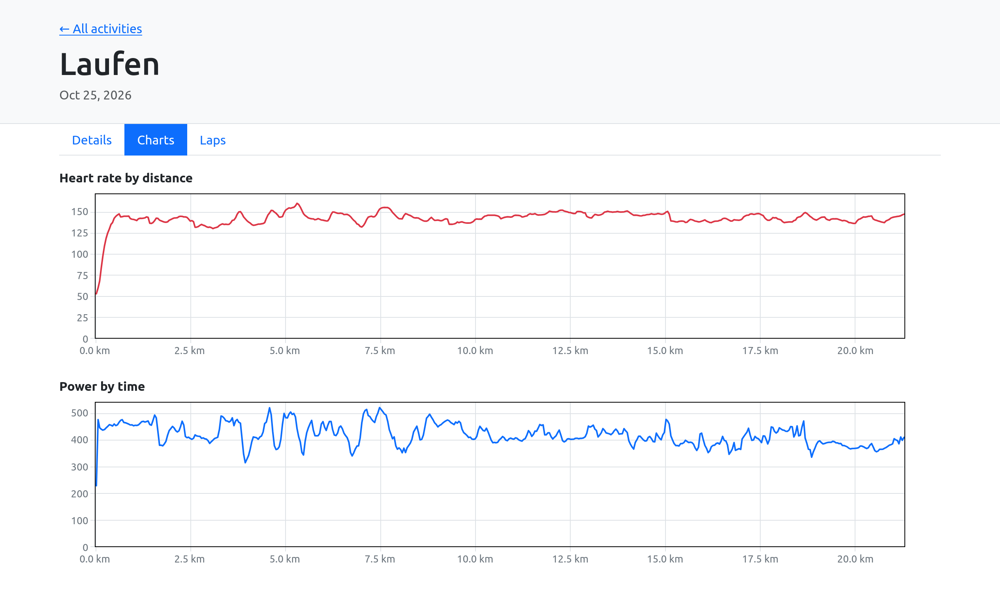
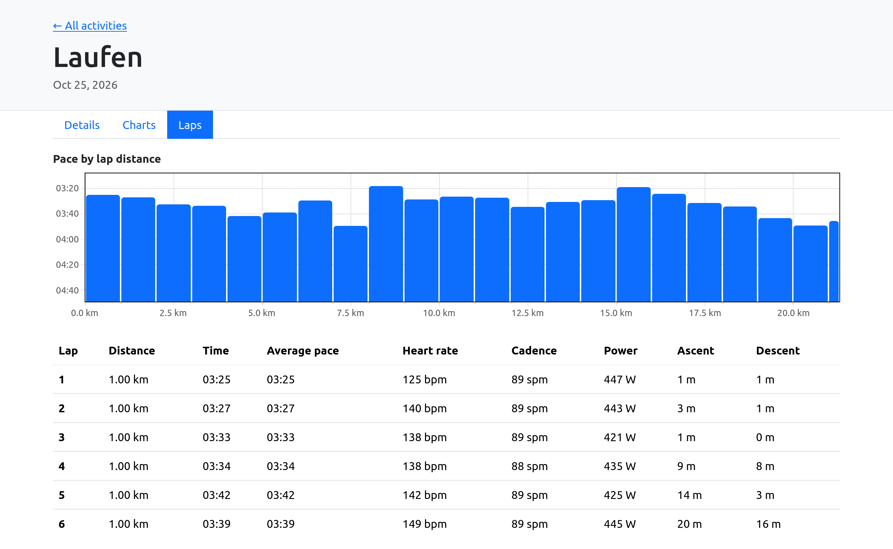

# Runstack

Runstack is a self-hosted web application for analyzing personal running data. It imports activity data from FIT files and provides an overview of recorded runs, including details such as distance, duration, pace, and lap statistics.

## Intended use

Runstack is designed for personal use on a private home network. A typical deployment could use a Raspberry Pi or another small home server to run the application and store your activity data locally.

> [!WARNING]
> Runstack is not intended to be exposed to the public internet. Authentication, authorization, and other security measures required for a publicly accessible service are not currently implemented. The application supports a single user only.

## Project goals

Runstack is primarily a learning project. Its goals are to:

- Gain practical experience with AI-assisted software development and explore where AI tools are useful throughout the development process.
- Gain experience with Angular and Spring Boot while keeping up to date with their current features, patterns, and recommended practices.
- Build and maintain a complete application across the frontend, backend, database, testing, and deployment layers.

## Why a running analysis platform?

I am a passionate and ambitious runner who enjoys exploring statistics and working with data. Running activities contain a wealth of information—from distance, pace, and laps to heart rate, cadence, power, and elevation—which makes them an ideal foundation for experimenting with different forms of analysis and visualization.

Runstack is also intended as an alternative to analysis features that existing platforms place behind paid subscriptions. Since the underlying activity data is generated and collected by me, I want the freedom to use it without artificial restrictions and to create the statistics, visualizations, and analysis tools that are genuinely useful to me.

Building those tools presents interesting engineering challenges, including file parsing, data modeling, persistence, API design, calculations, and responsive data visualization. At the same time, self-hosting keeps the activity data under my control and allows the platform to evolve around my own training and analysis needs.

## Features

- Import running activities from FIT files.
- Explore activity data through charts for metrics such as heart rate and power.
- Analyze lap pace visually and inspect detailed lap statistics, including heart rate, cadence, power, ascent, and descent.

### Activity charts

### Lap analysis

## Technology

- Angular frontend
- Spring Boot backend
- PostgreSQL database with Flyway migrations
- Garmin FIT SDK for importing activity files

## Current status

Runstack is under active development and should be considered experimental. Features, APIs, and the database schema may change as the project evolves.
